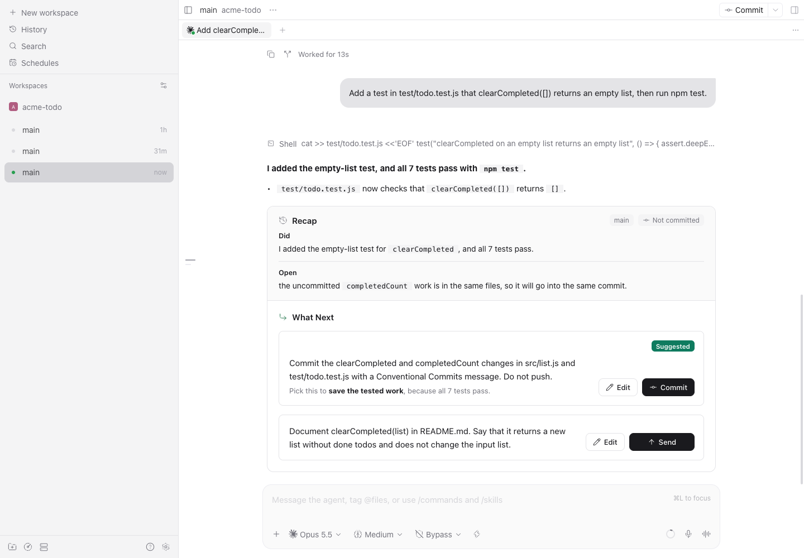

# Next prompt panel

Turns the end of an agent reply into a panel: the Recap as labeled fields, and each suggested next
prompt as a row with **Send**, **Edit**, and **New thread** buttons. Click Send and the prompt goes
to the same conversation. You do not need to copy and paste.



The image comes from Paseo 0.12.0, with sample data.

## What the panel does

- The panel replaces the reply from its last `## What Next`, `## What's Next`, or `## Next Steps`
  heading. It also replaces a recognized `## Recap` directly before that heading. The plugin renders
  the reply text above them itself, because Paseo 0.12 transformers replace the whole reply. Code
  blocks have no syntax colors, and tables show as monospace text.
- A reply without an eligible suggestion block keeps the normal Paseo rendering.
- Only the latest reply has active buttons. Earlier panels stay readable.
- **Send** sends the prompt in this conversation and keeps your composer draft.
- **Edit** writes the prompt into the composer so you can change it before you send it. It is
  available on desktop and web only; mobile clients hide it.
- **New thread** starts the prompt in a new conversation with the same provider, model, mode, and
  folder. On desktop and web, hover over Send and hold Command (Control off macOS) to swap Send
  for New thread. Mobile shows a separate New thread button.
- A prompt marked `thread: new` is listed under **Other work** and offers Start in new thread.
- A prompt that asks to commit gets a **Commit** button, which sends `/commit --no-push` with the
  prompt. **Commit & Push** sends `/commit`, and **Push** sends the prompt as written. Your agent
  needs a `/commit` command or skill for these. Git actions are never sent together with other
  prompts.
- Each prompt is sent at most once. If the send result is unknown, the button shows **Check chat**
  and is not retried.

## Make your agent write the format

The panel only reads replies in the shape below. Add these rules to your agent instructions, such
as `CLAUDE.md` or `AGENTS.md`:

````markdown
End each task reply with these two sections.

## Recap

- <branch> · <commit state, for example "not committed" or "committed abc1234">
- Did: <one sentence on what this turn did>
- Open: <unfinished work, if any>
- Need from you: <actions for the user, if any>

## What Next

```text
prompt: <the next prompt to send>
why: <optional reason, shown under the prompt and never sent>
```
````

- `Open` and `Need from you` are optional. Did, Open, and Need from you can hold a nested list.
- A Recap in another shape is not folded: it stays in the reply text above the panel.
- Two older Recap shapes also work: `Branch`, `Did`, `Commit/push` as three labeled bullets, and
  `Branch`, `Commit/push`, `Did`, `Not yet`, `Need from you` as five.
- A plain fence can hold several `prompt:` lines. Each can have its own `why:`, `thread: new`
  (unrelated work), and `suggestion: true` (shows a **Suggested** badge).

For several prompts that can be sent together, use a `next-prompts` fence with JSON:

````markdown
```next-prompts
{
  "version": 1,
  "prompts": [
    { "id": "docs", "prompt": "Document the new function.", "why": "Users can find it." },
    { "id": "test", "prompt": "Add an empty-list test.", "suggestion": true }
  ],
  "exclusiveGroups": [],
  "allowedCombinations": [["docs", "test"]]
}
```
````

- `exclusiveGroups` lists prompts where you can pick at most one.
- `allowedCombinations` lists the exact sets that you can send together as one numbered message.
  Without it, each prompt is sent alone.
- A prompt can also set `"thread": "new"` and `"suggestion": true`. The block can set
  `"goal": "done"`, which shows **Task done**.

## Data

- The daemon part reads the conversation's latest turn to check that a prompt is current, and sends
  prompts through the Paseo API. It makes no network calls of its own.
- It keeps the send state of each prompt in `$PASEO_HOME/plugin-data/next-prompt-panel/state.json`
  (mode 600), so a restart never sends a prompt twice.

## Requirements

- Paseo 0.12.0 or later. Turn on **Settings → Plugins → Enable plugins** first; it starts off.

## Install

From GitHub:

```bash
paseo plugin add git:HiepPP/hiep-paseo-plugin:plugins/next-prompt-panel
```

From a clone:

```bash
cd plugins/next-prompt-panel
npm install
npm run typecheck
npm test
paseo plugin install "$PWD"
```

Reload after source edits with `paseo plugin reload next-prompt-panel`.
